# FoldMobileGym · A Foldable Phone Simulator for the Web

[简体中文](README.md) | **English**

Explore foldable phone app layouts and split-screen interactions in your browser.

**FoldMobileGym** is a web-based simulator for foldable mobile apps. Without connecting a physical phone, you can switch between folded and unfolded screens, explore simulated apps such as the launcher, calendar, weather, and notes, and see how interfaces and interactions adapt to different screen sizes.

The project also includes a [screenshot-based agent](#screenshot-based-agent) that uses a vision model to read the simulator screen and perform clicks, typing, swipes, and other actions. It saves step-by-step screenshots, action records, and task evaluation results for GUI automation experiments and review.

The accompanying public [task dataset](#task-data) in [`tasks/`](tasks/) currently contains **50 task templates and 120 task instances** covering single-app, sequential cross-app, and multi-window tasks with a fixed unfolded screen. It provides task instructions, initial simulated data, and evaluation configurations for agent runs and regression tests. New datasets will be added in the future.

This project provides a simulated experience and is still being improved. All in-app content and actions are examples; they cannot make real calls, payments, purchases, or send messages.

## What You Can Explore

- **Folded and unfolded screens**: Switch between screen states and observe changes to the launcher and app layouts.
- **Multiple windows**: Try two-app split screen, three-pane split screen when unfolded, and floating windows that you can move, resize, and minimize. Two-app split screen supports adjustable proportions. When unfolded, you can switch between side-by-side and stacked layouts; folding the screen switches to a stacked layout.
- **Everyday app interfaces**: Browse Calendar, Weather, Clock, Calculator, Notes, Gallery, Maps, and simulated apps such as WeChat, Meituan, and Taobao. Available features vary by app and version.
- **Common system interactions**: Explore the launcher, recent apps, system back navigation, status bar, keyboard, and simulated permission prompts.

The current version includes **30 simulated apps**, covering everyday apps and system tools. The range of available features differs between apps.

It is suited to anyone interested in foldable phone interactions, comparing screen layouts, or demonstrating multitasking scenarios.

[Watch the demo (about 64 seconds)](https://github.com/user-attachments/assets/ee175436-2e33-4813-834c-dd9afb31efb5)

## Screenshots

All screenshots below are from the simulator. The apps and data shown are simulated examples.

| Folded launcher                                                                       | Unfolded launcher                                                                         |
| ------------------------------------------------------------------------------------- | ----------------------------------------------------------------------------------------- |
| 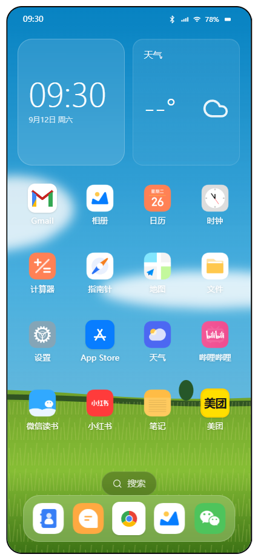 | 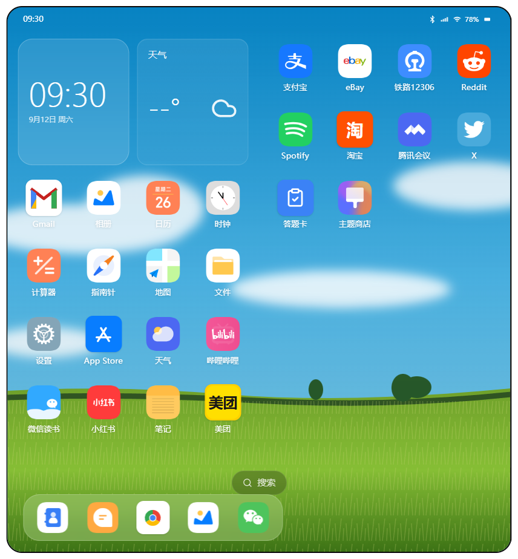 |

| Unfolded: side-by-side split screen                                                         | Folded: stacked split screen                                                         |
| ------------------------------------------------------------------------------------------- | ------------------------------------------------------------------------------------ |
| 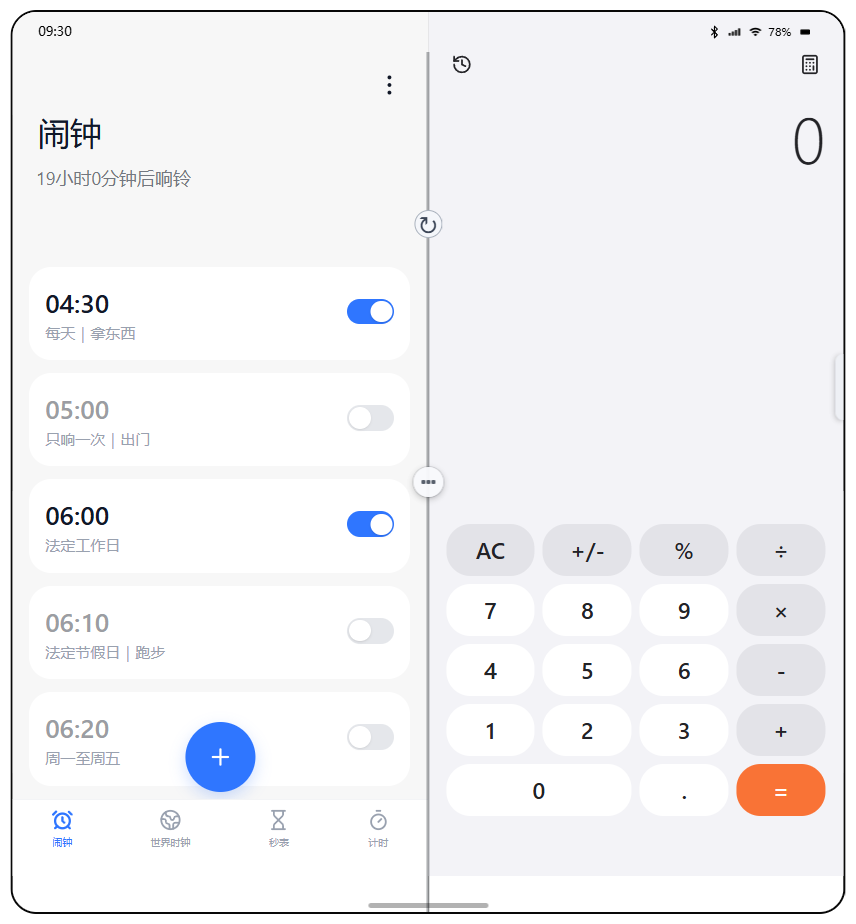 | 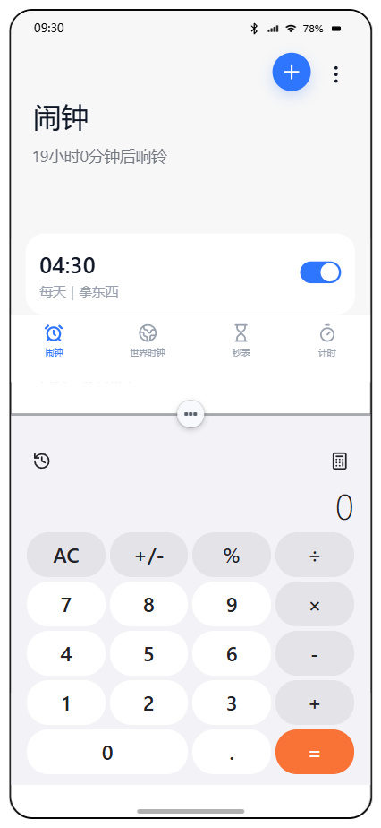 |

| Folded: note editor                                                                          | Unfolded: note list and editor                                                                            |
| -------------------------------------------------------------------------------------------- | --------------------------------------------------------------------------------------------------------- |
| 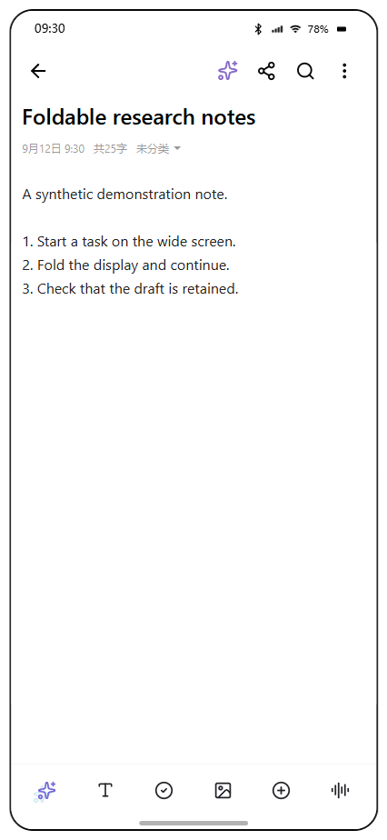 | 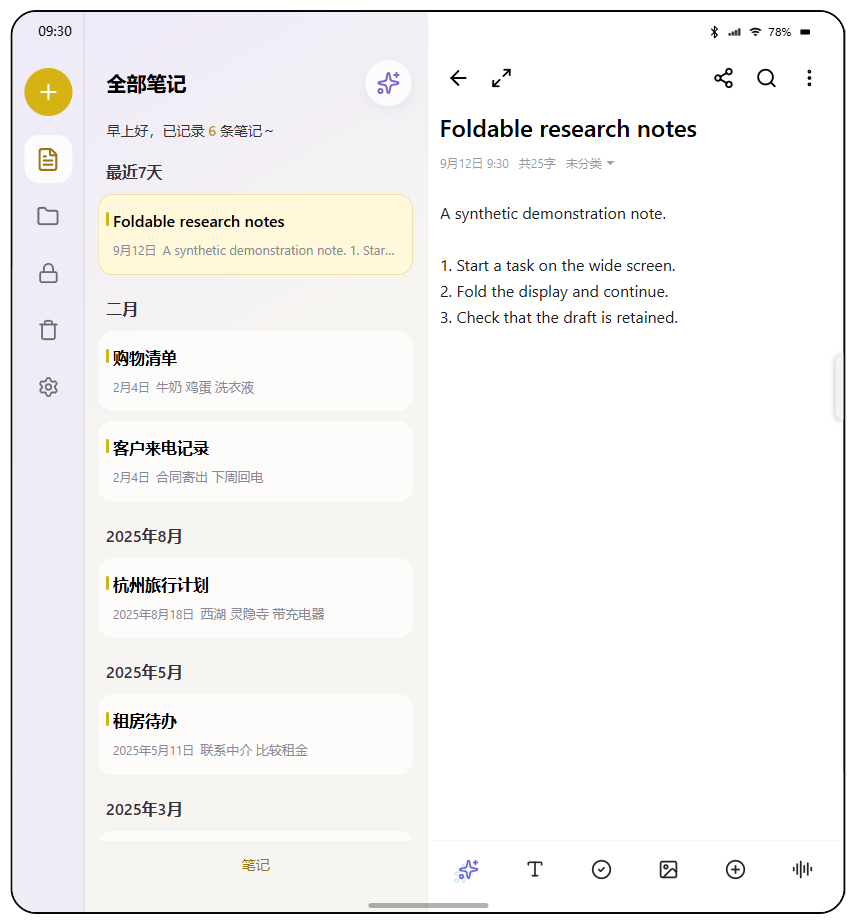 |

| Folded: weather forecast                                                                              | Unfolded: weather forecast                                                                                |
| ----------------------------------------------------------------------------------------------------- | --------------------------------------------------------------------------------------------------------- |
| 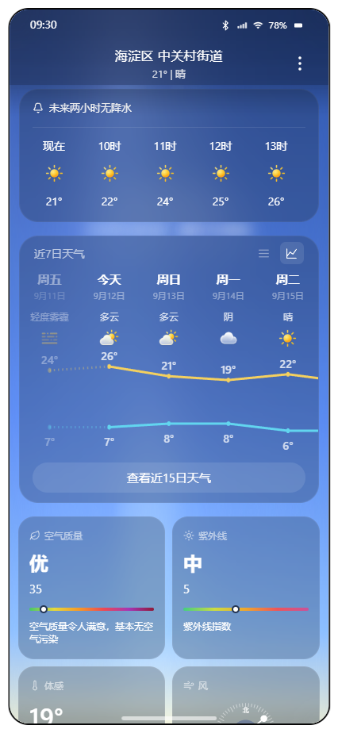 | 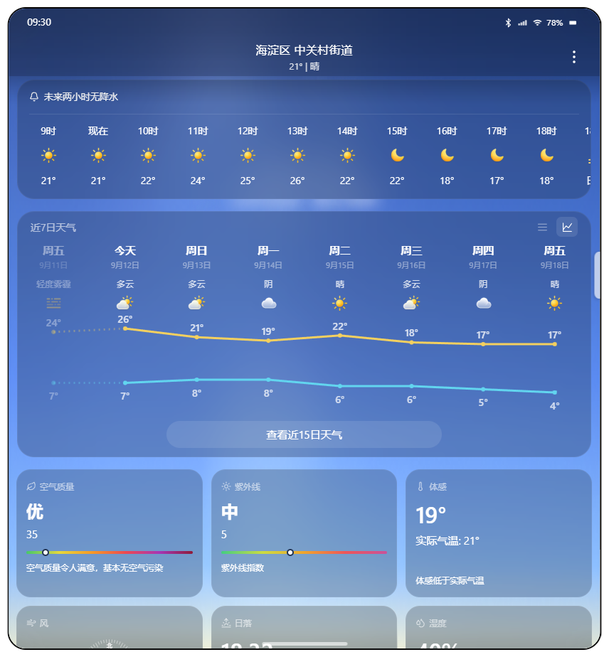 |

| Calendar                                                                                  | Calculator                                                                                    |
| ----------------------------------------------------------------------------------------- | --------------------------------------------------------------------------------------------- |
| 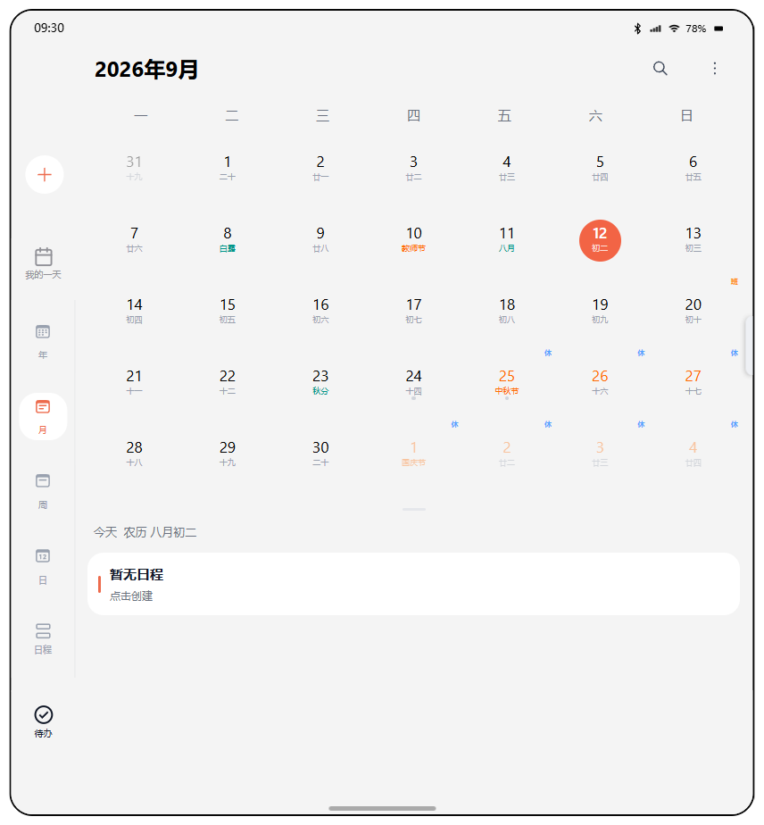 | 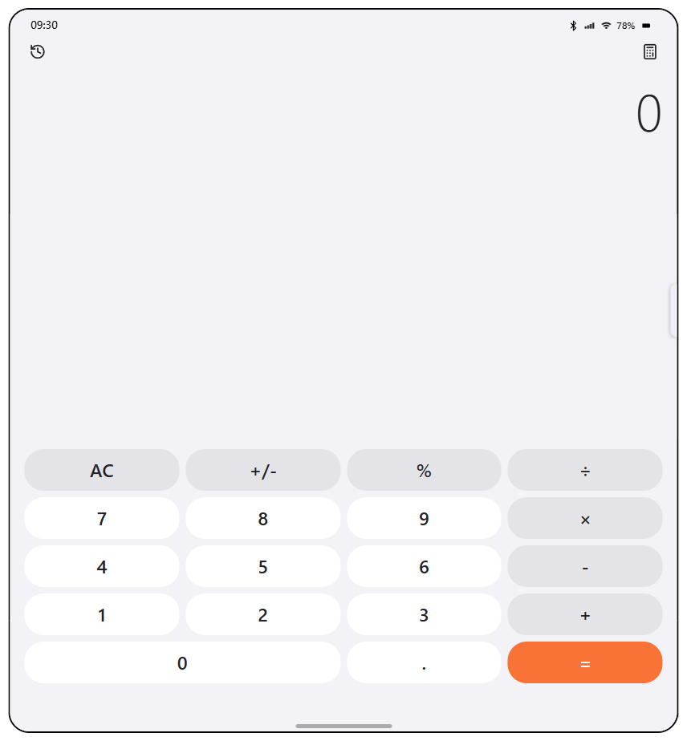 |

| Meituan                                                                                 | Music player                                                                                                |
| --------------------------------------------------------------------------------------- | ----------------------------------------------------------------------------------------------------------- |
|  | 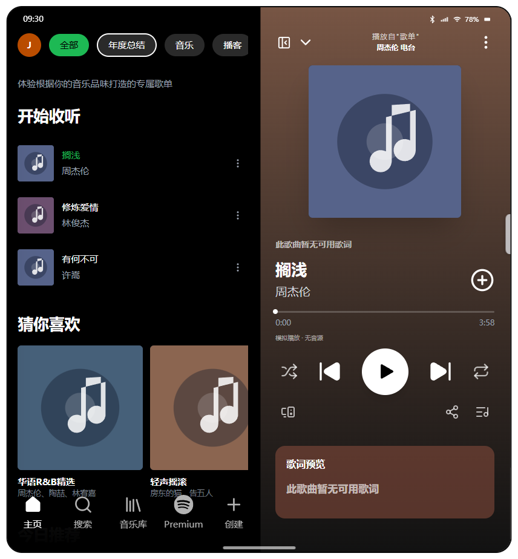 |

## Directory Structure

```text
foldmobilegym/                 Project repository root
├── README.md                  Chinese installation and usage guide
├── README.en.md               English installation and usage guide
├── foldmobilegym/             Web simulator; install npm dependencies and start it here
│   ├── apps/                  Simulated everyday apps
│   ├── system/                System tools such as Calendar, Notes, and Settings
│   ├── os/                    Home screen, system navigation, and multi-window interactions
│   └── public/                Static assets and simulated files
├── foldagent/                 Screenshot agent
│   ├── README_EN.md           Complete agent usage guide
│   ├── examples/              Bundled task examples
│   └── runs/                  Screenshots, action replays, and results generated during runs
├── foldagent_runtime/         Task initialization and execution components used by the agent
├── tasks/                     Public task data and running instructions
│   └── unfolded_static/       Single-app, cross-app, and multi-window tasks in the unfolded state
├── tools/
│   ├── browser-extension/     Fold and split-screen control extension
│   ├── media/                 Media package installation and checking tools
│   └── release/               Source export, release checks, and audits
└── media_sources/             Media documentation, source records, and README screenshots
```

**Both the repository root and the simulator subdirectory are named `foldmobilegym`. Run the media installation and agent commands below from the repository root. Run `npm ci` and `npm run dev` from the `foldmobilegym` subdirectory inside it.**

## Getting Started

To use the simulator, install and start it on your computer, then open it in a browser. The media package download is about 2.1 GB and expands to about 2.7 GB. Allowing for project files, dependencies, and temporary installation space, we recommend at least 15 GB of free space on the same drive. The media package provides images and other in-app assets.

### 1. Prepare Your Environment

Install the following tools first:

- [Git](https://git-scm.com/downloads)
- [Node.js](https://nodejs.org/) 24.14.0 or later, including npm
- [Python 3](https://www.python.org/downloads/)
- Chrome or Edge is recommended. Other Chromium browsers must support loading this project's browser extension.

Steps 2 and 3 use Windows PowerShell. Linux / macOS commands are provided below. The verified reference environment is Windows with Node.js 24.14.0, npm 11.9.0, and Python 3.11.9.

Windows examples use `npm.cmd` to avoid PowerShell execution-policy restrictions on `npm.ps1`; no system policy change is needed. Use a Node version that meets the project requirement; some development dependencies do not support Node 23.

### 2. Download the Project and Media Package

Open PowerShell in a location with sufficient free space and run:

```powershell
git clone https://github.com/yannnf/foldmobilegym.git
cd foldmobilegym
```

Visit the [media package release page](https://github.com/NaiboWang/foldmobilegym/releases/tag/media-v0.3.0) and download [`foldagent-gui-media-full-v0.3.0.tar.gz`](https://github.com/yannnf/foldmobilegym/releases/download/media-v0.3.0/foldagent-gui-media-full-v0.3.0.tar.gz).

In the same PowerShell window, run the following command, replacing the example path with the actual location of your downloaded media package:

```powershell
python tools/media/install_media_package.py --archive "C:\Downloads\foldagent-gui-media-full-v0.3.0.tar.gz"
```

The installer validates and installs the assets. Wait for it to finish successfully before continuing. Installation may take some time because there are many files. Do not start another installation while it is running or manually extract the archive over the project files.

### 3. Start and Open the Simulator

Once installation succeeds, run these commands in order in the same PowerShell window:

```powershell
cd foldmobilegym
$env:PUPPETEER_SKIP_DOWNLOAD = "true"
npm.cmd ci --no-audit --no-fund
npm.cmd run dev -- --host 127.0.0.1 --port 3100 --strictPort
```

After the server starts successfully, open **[http://127.0.0.1:3100/](http://127.0.0.1:3100/)** in your browser. This address is accessible only from the computer running the server.

Keep the PowerShell window running while using the simulator. Press `Ctrl+C` in that window to stop the server when you are done.

For subsequent sessions, open PowerShell in the repository root and run:

```powershell
cd foldmobilegym
npm.cmd run dev -- --host 127.0.0.1 --port 3100 --strictPort
```

### 4. Linux / macOS Installation and Startup

First install Git, Node.js 24.14.0 or later (including npm), Python 3 (3.11 or later recommended), and Chrome or Edge. The commands below work in bash / zsh. Use the same media package as on Windows and reserve at least 15 GB of free space.

Download [`foldagent-gui-media-full-v0.3.0.tar.gz`](https://github.com/yannnf/foldmobilegym/releases/download/media-v0.3.0/foldagent-gui-media-full-v0.3.0.tar.gz) from the [media package release page](https://github.com/NaiboWang/foldmobilegym/releases/tag/media-v0.3.0). Open a terminal where you want to store the project and run these commands in order:

```bash
git clone https://github.com/yannnf/foldmobilegym.git
cd foldmobilegym

# Replace the path below with the actual location of your downloaded media package
python3 tools/media/install_media_package.py --archive "$HOME/Downloads/foldagent-gui-media-full-v0.3.0.tar.gz"

# Wait for media installation to succeed before installing dependencies and starting the simulator
cd foldmobilegym
PUPPETEER_SKIP_DOWNLOAD=true npm ci --no-audit --no-fund
npm run dev -- --host 127.0.0.1 --port 3100 --strictPort
```

After the server starts successfully, open **[http://127.0.0.1:3100/](http://127.0.0.1:3100/)** in your browser and keep the terminal running. Press `Ctrl+C` to stop the server. For subsequent sessions, run the same `npm run dev` command from the project's `foldmobilegym` subdirectory.

Use `python3` to check installed assets as well: run the media installation command from the repository root with `--check-only` appended. Browser extension installation and in-page interactions are the same as described below.

### 5. Switch Between Folded and Unfolded Screens

The project includes a local Chrome / Edge browser extension for manually switching screen states:

1. Open `chrome://extensions` (Chrome) or `edge://extensions` (Edge) in the browser address bar.
2. Enable **Developer mode** and click **Load unpacked**.
3. Select the `tools/browser-extension` folder in the downloaded project.
4. Open the simulator page and click the extension icon in the browser toolbar.
5. Select **Fold (折叠)** or **Unfold (展开)**.

To try split screen, use the simulator's system split-screen control and choose a second app from the launcher. Alternatively, open two different apps first, then refresh the task list in the extension, select the tasks, and apply a split-screen layout.

The extension controls the simulator on the web page. Folded and unfolded states are currently supported; a partially folded state is not yet supported.

### 6. Use the Simulator with a Mouse

Click inside the simulated screen to select an app or button. Hold the left mouse button and drag to simulate a swipe. Use the bottom gesture bar as described below:

| Action                        | Mouse interaction                                                                                                                         |
| ----------------------------- | ----------------------------------------------------------------------------------------------------------------------------------------- |
| Go back                       | In single-window mode, drag horizontally inward from the left or right edge of the simulated screen, then release.                        |
| Return to the launcher        | Quickly drag upward from the bottom gesture bar and release.                                                                              |
| Open recent apps              | Drag upward from the bottom gesture bar, keep holding, and pause briefly.                                                                 |
| Switch apps                   | Open recent apps, then click the desired app card.                                                                                        |
| Create a two-app split screen | While unfolded, open an app, drag diagonally up and left from the bottom gesture bar, release, then choose another app from the launcher. |
| Open a floating window        | While in an app, drag diagonally up and right from the bottom gesture bar and release.                                                    |

### 7. Adjust and Exit Multiple Windows

**Two-app split screen**: Drag the divider between the windows to adjust their proportions. While unfolded, click the “↻” button on the divider to switch between side-by-side and stacked layouts. Folding automatically switches to a stacked layout; unfolding again restores the previously selected orientation.

To exit split screen, drag the divider to the edge of the screen and release. The remaining app returns to full screen. You can also click **Single window (单窗口)** in the extension. In two-app split screen, dragging horizontally inward from the outer screen edge next to an app closes that app and returns the other app to full screen.

**Three-pane split screen**: While unfolded, open three different apps. Open the extension, click **Refresh status / tasks (刷新状态 / 任务)**, select the **Main window (主窗口)**, **Second window (第二窗口)**, and **Third window (第三窗口)**, then click **Three-pane split screen (三分屏)**. Drag the dividers to resize the panes. Three-pane split screen is available only when unfolded; folding exits multi-window mode.

**Floating windows**: Drag the top handle to move a window, or drag its bottom-right corner to resize it. Click “−” at the top to minimize, “□” to return to full screen, or “×” to close the floating window. After minimizing, click the app name on the screen to reopen the floating window.

## Screenshot-Based Agent

The project includes a GUI agent that operates from screenshots. It reads the simulator's current screen, uses a vision model to choose the next action, and executes clicks, typing, swipes, and back navigation in a separate browser window. Depending on the task configuration, it can also fold, unfold, and use split screen. Each action is recorded and independently checked by the simulator, allowing you to observe how the agent performs calculations, fills in content, switches apps, or handles foldable layouts.

The agent runs in a separate temporary browser window and does not take over your everyday browser tabs. It supports predefined and custom tasks. Each run saves the initial screen, screenshots of every step, action records, and the final verdict for review. Results are saved to `foldagent/runs/` by default.

Published tasks are in [`tasks/unfolded_static/`](tasks/unfolded_static/). See [Task Data](#task-data) below for categories, file roles, and commands. `foldagent/examples/` retains a few introductory validation examples.

### Run an Example

Start the simulator as described above, then open another terminal at the repository root. On first use, create a Python environment, install the agent dependencies, and copy the configuration template. If `foldagent/.env` already exists, edit it directly instead of copying the template again.

**Windows PowerShell:**

```powershell
python -m venv .venv
.\.venv\Scripts\python.exe -m pip install -r foldagent_runtime/requirements.txt
Copy-Item foldagent/.env.example foldagent/.env
```

**Linux / macOS (bash / zsh):**

```bash
python3 -m venv .venv
.venv/bin/python -m pip install -r foldagent_runtime/requirements.txt
cp foldagent/.env.example foldagent/.env
```

If Linux reports that `venv` is missing, install the Python virtual environment component using your distribution's package manager, such as `python3-venv` on Debian / Ubuntu.

The agent attempts to locate Chrome / Chromium in common installation locations. If your browser is not detected, set the `FOLDAGENT_BROWSER_PATH` environment variable to its executable path. See the [agent guide](foldagent/README_EN.md) for details.

Next, edit `foldagent/.env` with your vision model and API settings. The following `node` commands work on Windows, Linux, and macOS.

First run the preflight check without a model. It initializes the task and saves a screenshot without calling a model or using API quota:

```powershell
node foldagent/run.mjs --task-file foldagent/examples/calculator.task.json --seed-file foldagent/examples/calculator.seed.json --check
```

Once the preflight check passes, remove `--check` and load the configuration file to run the agent:

```powershell
node --env-file=foldagent/.env foldagent/run.mjs --task-file foldagent/examples/calculator.task.json --seed-file foldagent/examples/calculator.seed.json --max-steps 12 --headed
```

This example asks the agent to calculate `12 + 7 = 19` in Calculator and checks the calculation history. The `passed` field in `result.json` determines whether the task passed. Passing the preflight check only confirms that initialization works.

The model must support image input and structured output. You configure the model name, API endpoint, and key yourself. Screenshots are sent to the configured model service only when you explicitly run in model mode. Do not include private communications, account information, keys, or other unauthorized content in task data or screenshots.

The screenshot-based agent is intended for experiments, demonstrations, and task validation. It is not guaranteed to complete every task, and its results do not represent success rates on physical phones or official benchmark scores. For the complete task format, folding and split-screen options, result fields, and troubleshooting, see the [agent guide](foldagent/README_EN.md).

## Task Data

[`tasks/`](tasks/) contains public task data shared by the screenshot-based agent and regression tests. The currently published `unfolded_static/` task set keeps the screen unfolded and includes **120 task instances**. The instance count includes variants with different content and split-screen orientations. New datasets will be added in the future.

| Task directory                                                          | Category                                               | Task instances |
| ----------------------------------------------------------------------- | ------------------------------------------------------ | -------------: |
| [`single_app/`](tasks/unfolded_static/single_app/)                     | Complete operations within one app                     |             56 |
| [`cross_app_sequential/`](tasks/unfolded_static/cross_app_sequential/) | Switch apps sequentially to read and enter information |             24 |
| [`multi_window/`](tasks/unfolded_static/multi_window/)                 | Read and enter information across split-screen panes   |             40 |
| Total                                                                   |                                                        |            120 |

Each task type has an `SAxx`, `CAxx`, or `MWxx` directory with `instances/base/` and a second test content instance. The latter is usually `instances/test03/`; `CA05` and `MW05` use `instances/test02/`. Multi-window tasks additionally provide `side_by_side/` and `stacked/` split-screen variants. Each instance contains these files:

- `static.task.json`: Task instructions, initial screen and window layout, event configuration, and evaluation criteria, using the `foldmobilegym.task.v2` format.
- `seed.json`: Initial simulated data for apps, the system, and files.
- `gold.private.json`: Synthetic reference answers for evaluation or regression tests. The name `private` is historical; these files are public data. Use them only for evaluation or testing, and do not include them in the agent's model input.

The main [`manifest.json`](tasks/unfolded_static/manifest.json) lists task IDs, categories, content instances, window orientations, task and seed paths, and validation status. Its `task` and `seed` paths, as well as `initial_state` in task files, are resolved relative to the **repository root**.

### Run a Task

Install and start the simulator as described above, then install the agent dependencies and configure `foldagent/.env`. Run the following commands from the repository root. This example uses the `SA01/base` note-editing task, starting with a browser preflight check without a model:

```powershell
node foldagent/run.mjs --task-file tasks/unfolded_static/single_app/SA01/instances/base/static.task.json --seed-file tasks/unfolded_static/single_app/SA01/instances/base/seed.json --run-seed 0 --prompt-version v4 --check
```

Once the preflight check passes, load the model configuration and run the same task:

```powershell
node --env-file=foldagent/.env foldagent/run.mjs --task-file tasks/unfolded_static/single_app/SA01/instances/base/static.task.json --seed-file tasks/unfolded_static/single_app/SA01/instances/base/seed.json --run-seed 0 --prompt-version v4 --headed
```

To run another task, replace `--task-file` and `--seed-file` with the corresponding paths from the main manifest. Fixed unfolded tasks require `--run-seed 0` and `--prompt-version v4`; multi-window tasks allow split-screen operations according to their protocol.

Manifest statuses such as `gui_validation_required` do not establish completed end-to-end GUI validation. Passing format or initialization checks also does not establish that a model completed the task. The `passed` field in each run's `result.json` under `foldagent/runs/` determines the result. See the [task guide](tasks/README.en.md) for more directory details, initialization checks without a browser, and regression tests.

## Suggested First Steps

1. Open Calendar, Weather, or Notes from the launcher to explore the app interface.
2. Switch between folded and unfolded screens to compare content arrangement and visible area.
3. Open two apps in split screen, switch screen states again, and observe the change between side-by-side and stacked layouts.
4. Use system back navigation or recent apps to switch between apps.

## FAQ

**Do I need a foldable phone?**

No. The simulator runs in a desktop browser without connecting to a phone.

**Can I just open a website and use it?**

This guide currently covers local installation. Install and start the simulator first, then open its local address.

**Can I use real WeChat, Meituan, or Taobao services?**

The apps and content are simulated. They cannot send real messages, make payments, place orders, make calls, or hold meetings. Some notifications, maps, media, and more detailed interaction flows are still being improved.

**Can it run completely offline?**

The local media package provides some runtime assets, but certain external images and services still require network access. Fully offline use is therefore not guaranteed.

**What if the page does not open?**

Make sure the PowerShell window running the server is still open and check that the terminal reports a successful startup. If port 3100 is already in use, change `--port 3100` to `--port 3101` in the startup command, restart the server, and open the address shown in the terminal.

**What if images are missing or media installation fails?**

Check that the media package was fully downloaded, its path is correct, and Python runs properly. After installation, run the following command from the repository root to check the assets, replacing the example path with the actual download location:

```powershell
python tools/media/install_media_package.py --archive "C:\Downloads\foldagent-gui-media-full-v0.3.0.tar.gz" --check-only
```

Some images also require network access, so check your connection. If you see errors about insufficient disk space or Windows path length limits, move the project and media package to a drive with sufficient space and use shorter folder paths.

## Usage Notes and Licensing

FoldMobileGym is built on [MobileGym](https://github.com/Purewhiter/mobilegym) and provides a simulated experience of foldable interfaces and interactions. The current version is still being improved, and its interfaces and features may differ from physical devices.

The source code is licensed under Apache-2.0. The project includes data released under CC BY-NC 4.0, and rights to some third-party images, content, and brands belong to their respective owners. The code license does not mean that all assets may be used commercially. Check the applicable terms before using or redistributing them.

For full details, see the [code license](foldmobilegym/LICENSE), [data license](foldmobilegym/LICENSE-DATA), [third-party notices](foldmobilegym/NOTICE), and [disclaimer](foldmobilegym/DISCLAIMER.md).
