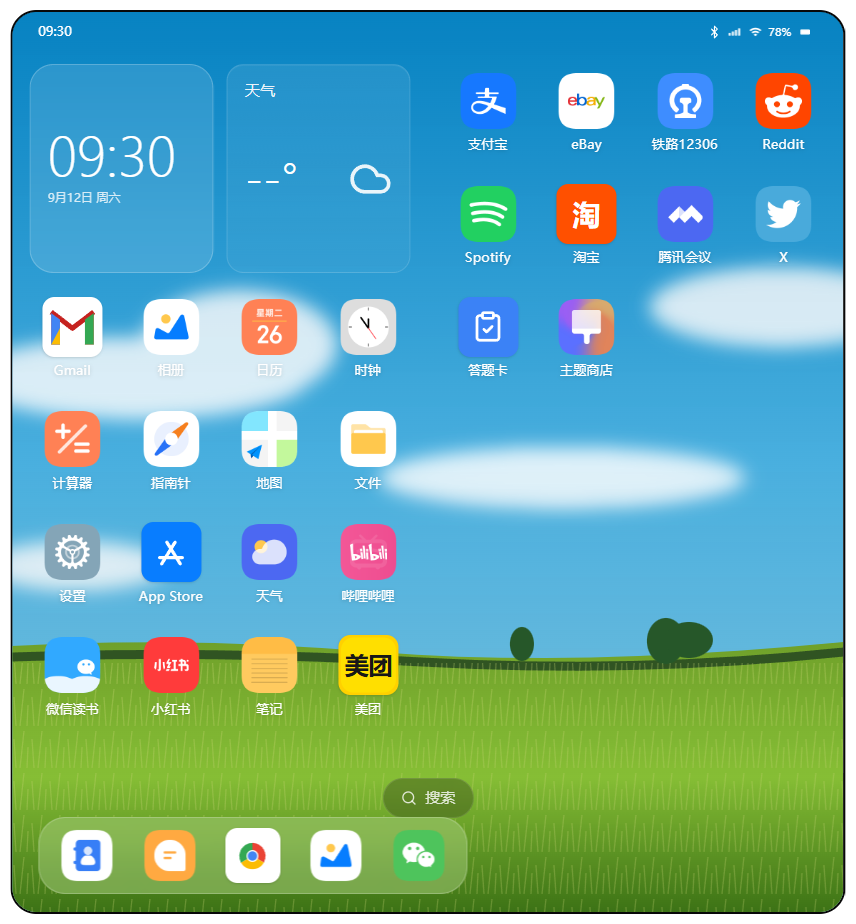
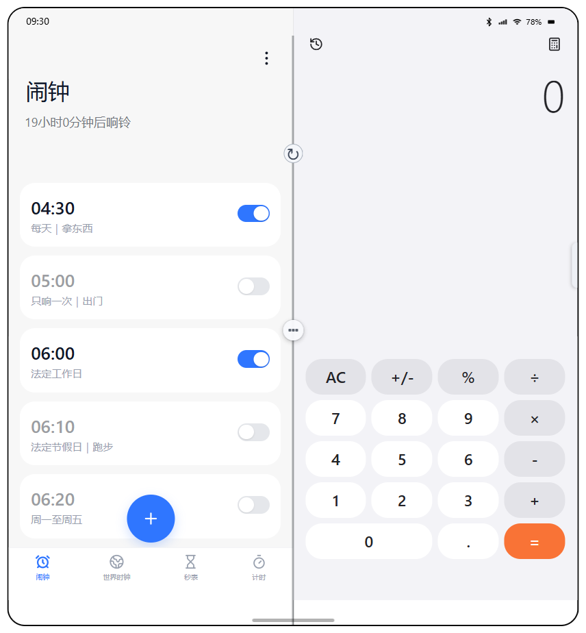
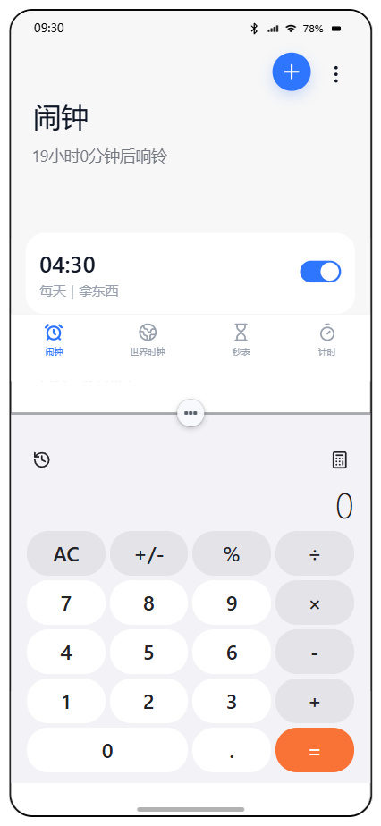
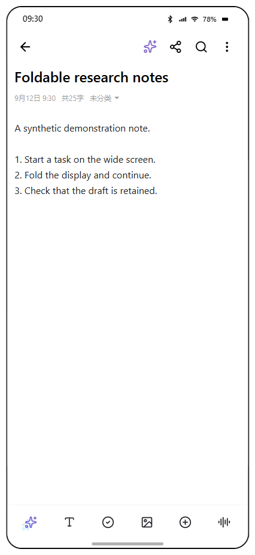
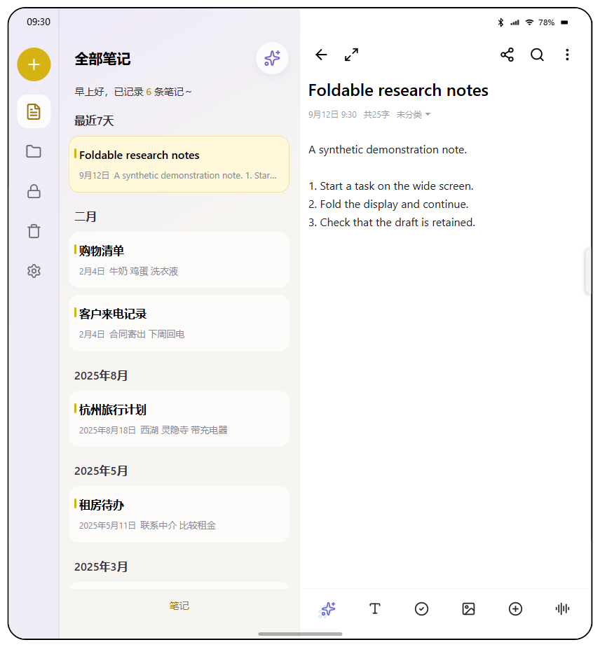
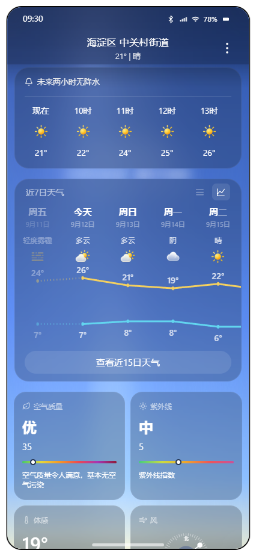
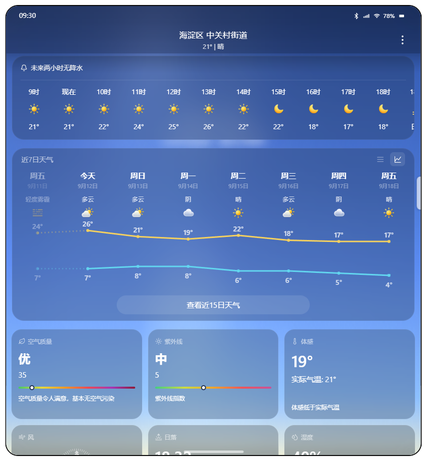
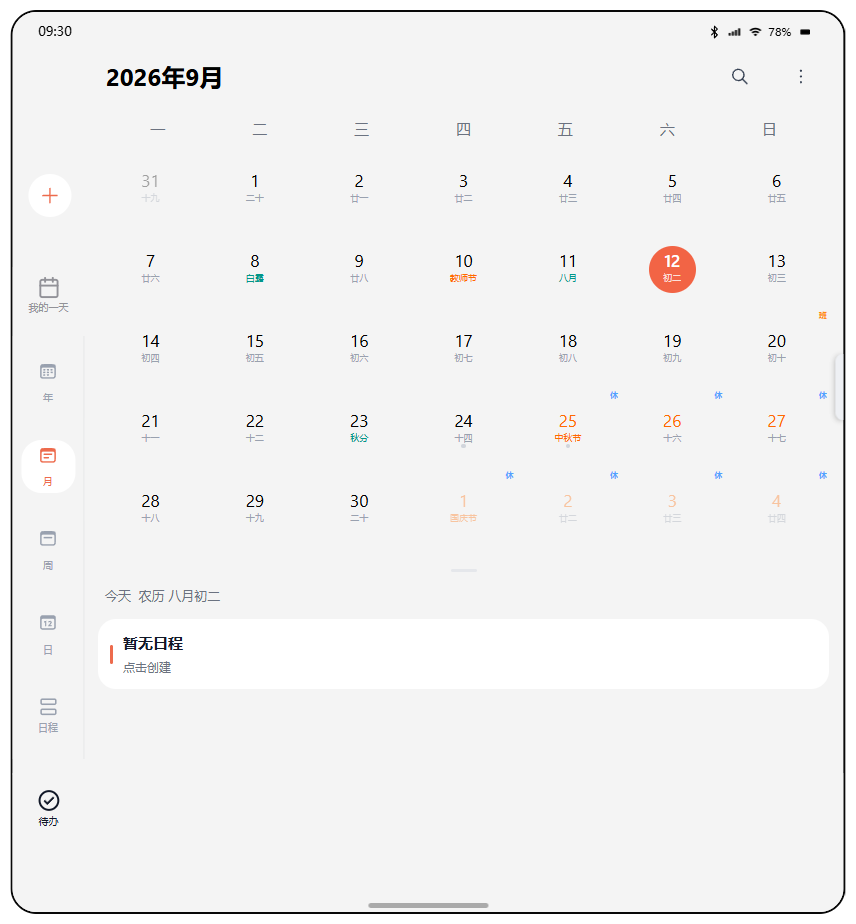
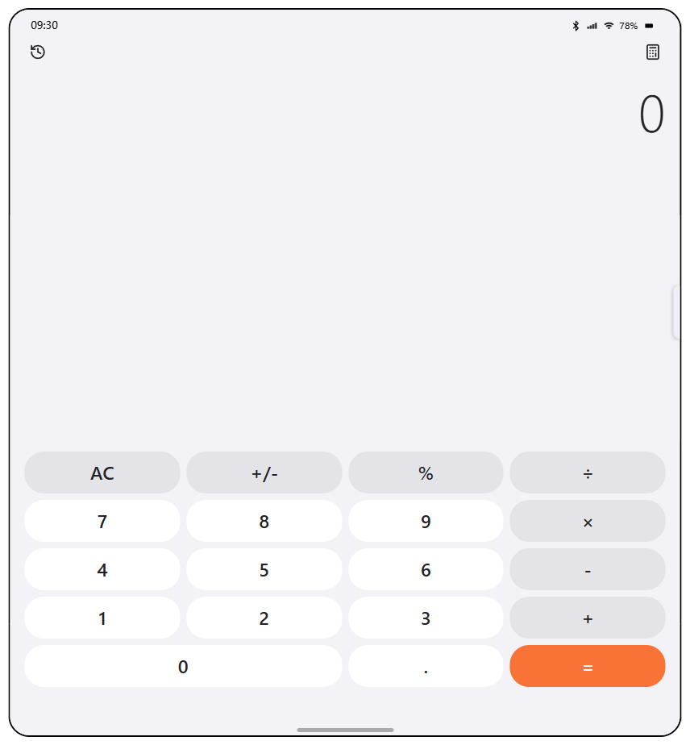
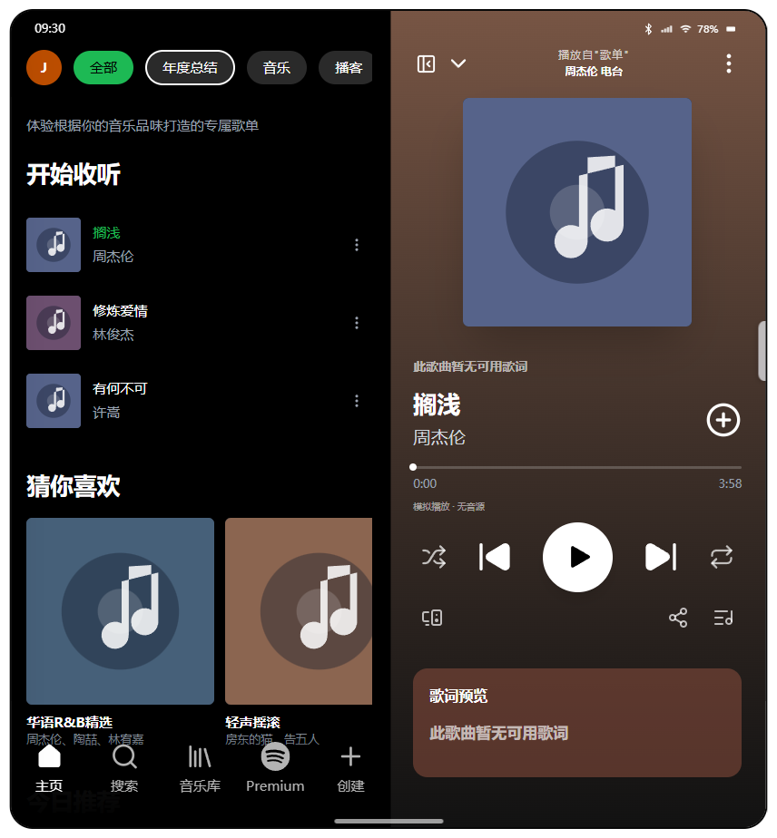

# FoldMobileGym· 网页版折叠屏模拟体验

**简体中文** | [English](README.en.md)

在浏览器里模拟体验折叠屏手机的应用布局与分屏操作。

**FoldMobileGym** 是一款网页版折叠屏移动应用模拟器。无需连接真实手机，即可在折叠与展开两种屏幕形态之间切换，体验桌面、日历、天气、笔记等模拟应用，了解不同屏幕尺寸下的界面与操作方式。

项目同时提供[截图 Agent](#截图-agent)，通过视觉模型读取模拟器画面并执行点击、输入、滑动等操作，保存逐步截图、动作记录和任务判定结果，支持 GUI 自动化实验与过程回看。

配套的公开[任务数据集](#任务数据)位于 [`tasks/`](tasks/)，当前包含固定展开态下的单应用、跨应用顺序操作和多窗口任务，共 **50 个任务模板、120 个任务实例**，提供任务指令、初始模拟数据及判定配置，供 Agent 运行和回归测试使用。后续会补充新数据集。

本项目提供模拟体验，仍在持续完善；应用中的内容与操作均为示例，不能用于真实通话、付款、下单或发送消息。

## 可以体验什么

- **折叠与展开**：切换屏幕形态，观察桌面和应用布局的变化。
- **多窗口体验**：支持双应用分屏、展开状态下的三分屏，以及可移动、调整大小和收起的悬浮窗。双分屏可调整比例；展开时可切换左右或上下布局，折叠后切换为上下布局。
- **日常应用界面**：浏览日历、天气、时钟、计算器、笔记、相册、地图，以及微信、美团、淘宝等模拟应用。各应用可体验的功能以当前版本为准。
- **常见系统操作**：体验桌面、最近任务、系统返回、状态栏、键盘和模拟权限提示。

当前版本提供 **30 个模拟应用**，包含日常应用和系统工具；各应用的可体验功能范围不同。

适合想了解折叠屏交互、比较不同屏幕布局，或展示多任务使用场景的用户。

[观看演示视频（约 64 秒）](https://github.com/user-attachments/assets/ee175436-2e33-4813-834c-dd9afb31efb5)

## 界面预览

以下截图均来自模拟器，画面中的应用和数据为模拟示例。

| 折叠桌面                                                                | 展开桌面                                                                  |
| ----------------------------------------------------------------------- | ------------------------------------------------------------------------- |
|  |  |

| 展开：左右分屏                                                                 | 折叠：上下分屏                                                               |
| ------------------------------------------------------------------------------ | ---------------------------------------------------------------------------- |
|  |  |

| 折叠：笔记编辑                                                                      | 展开：笔记列表与编辑                                                                        |
| ----------------------------------------------------------------------------------- | ------------------------------------------------------------------------------------------- |
|  |  |

| 折叠：天气预报                                                                      | 展开：天气预报                                                                        |
| ----------------------------------------------------------------------------------- | ------------------------------------------------------------------------------------- |
|  |  |

| 日历                                                                      | 计算器                                                                        |
| ------------------------------------------------------------------------- | ----------------------------------------------------------------------------- |
|  |  |

| 美团                                                                     | 音乐播放器                                                                                     |
| ------------------------------------------------------------------------ | ---------------------------------------------------------------------------------------------- |
|  |  |

## 目录结构

```text
foldmobilegym/                 项目仓库根目录
├── README.md                  中文安装与使用说明
├── README.en.md               英文安装与使用说明
├── foldmobilegym/             网页模拟器；在此目录安装 npm 依赖并启动
│   ├── apps/                  日常模拟应用
│   ├── system/                日历、笔记、设置等系统工具
│   ├── os/                    桌面、系统导航和多窗口交互
│   └── public/                静态资源与模拟文件
├── foldagent/                 截图 Agent
│   ├── README_ZH.md           Agent 完整使用说明
│   ├── examples/              自带的任务示例
│   └── runs/                  运行后生成的截图、操作回放和结果
├── foldagent_runtime/         Agent 使用的任务初始化与执行组件
├── tasks/                     公开任务数据与运行说明
│   └── unfolded_static/       展开态单应用、跨应用和多窗口任务
├── tools/
│   ├── browser-extension/     折叠与分屏控制扩展
│   ├── media/                 媒体包安装与检查工具
│   └── release/               源码导出、发布检查与审计
└── media_sources/             媒体说明、来源记录和 README 截图
```

**仓库根目录与模拟器子目录都叫 `foldmobilegym`。下文中的媒体安装和 Agent 命令从仓库根目录执行；`npm ci` 和 `npm run dev` 从其中的 `foldmobilegym` 子目录执行。**

## 开始使用

当前使用方式是在电脑上安装并启动，再通过浏览器访问。媒体包下载文件约 2.1 GB，解压后约 2.7 GB；考虑到项目文件、依赖和安装过程中的临时空间，建议在同一磁盘预留至少 15 GB 可用空间。媒体包用于提供应用中的图片等素材。

### 1. 准备运行环境

请先安装以下工具：

- [Git](https://git-scm.com/downloads)
- [Node.js](https://nodejs.org/) 24.14.0 或更高版本，包含 npm
- [Python 3](https://www.python.org/downloads/)
- 推荐使用 Chrome 或 Edge；其他 Chromium 浏览器需支持加载本项目的浏览器扩展。

第 2、3 步以 Windows PowerShell 为例，Linux / macOS 的安装命令见后文。已验证的参考环境为 Windows、Node.js 24.14.0、npm 11.9.0 和 Python 3.11.9。

Windows 示例使用 `npm.cmd`，可避免 PowerShell 的脚本执行策略拦截 `npm.ps1`，无需修改系统执行策略。Node 版本应满足项目要求；Node 23 不受部分开发依赖支持。

### 2. 下载项目与媒体包

在空间充足的位置打开 PowerShell，执行：

```powershell
git clone https://github.com/NaiboWang/FoldMobileGym.git
cd foldmobilegym
```

前往[媒体包下载页](https://github.com/NaiboWang/foldmobilegym/releases/tag/media-v0.3.0)，下载 [`foldagent-gui-media-full-v0.3.0.tar.gz`](https://github.com/NaiboWang/foldmobilegym/releases/download/media-v0.3.0/foldagent-gui-media-full-v0.3.0.tar.gz)。

在刚才的 PowerShell 中执行以下命令，将示例路径替换为媒体包的实际保存位置：

```powershell
python tools/media/install_media_package.py --archive "C:\Downloads\foldagent-gui-media-full-v0.3.0.tar.gz"
```

安装程序会校验并安装素材。请等待安装成功并结束后再继续；文件较多时可能需要一些时间，请勿重复启动安装，也不要手动解压覆盖项目文件。

### 3. 启动并打开网页

安装成功后，在同一个 PowerShell 中依次执行：

```powershell
cd foldmobilegym
$env:PUPPETEER_SKIP_DOWNLOAD = "true"
npm.cmd ci --no-audit --no-fund
npm.cmd run dev -- --host 127.0.0.1 --port 3100 --strictPort
```

启动成功后，在浏览器中打开 **[http://127.0.0.1:3100/](http://127.0.0.1:3100/)**。此地址仅供运行程序的这台电脑访问。

使用期间请保持 PowerShell 窗口运行。结束体验时，在该窗口按 `Ctrl+C` 停止程序。

以后再次使用，在仓库根目录打开 PowerShell，执行：

```powershell
cd foldmobilegym
npm.cmd run dev -- --host 127.0.0.1 --port 3100 --strictPort
```

### 4. Linux / macOS 安装与启动

请先安装 Git、Node.js 24.14.0 或更高版本（包含 npm）、Python 3（推荐 3.11 或更高版本），以及 Chrome 或 Edge。以下命令适用于 bash / zsh；使用的媒体包与 Windows 相同，也需要预留至少 15 GB 可用空间。

先从[媒体包下载页](https://github.com//foldmobilegym/releases/tag/media-v0.3.0)下载 [`foldagent-gui-media-full-v0.3.0.tar.gz`](https://github.com/NaiboWang/foldmobilegym/releases/download/media-v0.3.0/foldagent-gui-media-full-v0.3.0.tar.gz)。在准备保存项目的位置打开终端，依次执行：

```bash
git clone https://github.com/NaiboWang/FoldMobileGym.git
cd foldmobilegym

# 将下方路径替换为媒体包的实际下载位置
python3 tools/media/install_media_package.py --archive "$HOME/Downloads/foldagent-gui-media-full-v0.3.0.tar.gz"

# 等待媒体安装成功后，再进入模拟器目录安装依赖并启动
cd foldmobilegym
PUPPETEER_SKIP_DOWNLOAD=true npm ci --no-audit --no-fund
npm run dev -- --host 127.0.0.1 --port 3100 --strictPort
```

启动成功后，在浏览器中打开 **[http://127.0.0.1:3100/](http://127.0.0.1:3100/)**，并保持终端运行；按 `Ctrl+C` 可停止程序。以后再次使用时，在项目中的 `foldmobilegym` 子目录执行同一条 `npm run dev` 命令即可。

安装后的素材检查也使用 `python3`：在仓库根目录执行媒体安装命令并追加 `--check-only`。折叠控制扩展的安装和网页内操作与下文相同。

### 5. 切换折叠与展开

本项目提供 Chrome / Edge 本地浏览器扩展，用于手动切换屏幕形态：

1. 在浏览器地址栏打开 `chrome://extensions`（Chrome）或 `edge://extensions`（Edge）。
2. 开启“开发者模式”，点击“加载已解压的扩展程序”。
3. 选择下载项目中的 `tools/browser-extension` 文件夹。
4. 打开模拟器网页，点击浏览器工具栏中的扩展图标。
5. 选择 **折叠** 或 **展开**。

体验分屏时，可以使用模拟器中的系统分屏入口，从桌面选择第二个应用；也可以先打开两个不同的应用，再在扩展中刷新任务列表、选择任务并应用分屏布局。

扩展用于控制网页中的模拟器。目前支持折叠与展开两种形态，暂不支持半折叠形态。

### 6. 用鼠标操作模拟器

在模拟屏幕中点击即可选择应用或按钮，按住鼠标左键并拖动可模拟滑动。使用底部手势条时，可按下表操作：

| 操作         | 鼠标使用方法                                                                       |
| ------------ | ---------------------------------------------------------------------------------- |
| 返回上一页   | 在单窗口中，从模拟屏幕左侧或右侧边缘向内水平拖动并松开。                           |
| 回到桌面     | 从底部手势条快速向上拖动并松开。                                                   |
| 打开最近任务 | 从底部手势条向上拖动，保持按住并稍作停留。                                         |
| 切换应用     | 打开最近任务后，点击相应的应用卡片。                                               |
| 创建双分屏   | 在展开状态下打开一个应用，从底部手势条向左上方拖动并松开，再从桌面选择另一个应用。 |
| 打开悬浮窗   | 在应用中，从底部手势条向右上方拖动并松开。                                         |

### 7. 调整与退出多窗口

**双分屏**：拖动两个窗口之间的分隔条，可调整窗口占比。在展开状态下，点击分隔条上的“↻”按钮可切换左右分屏与上下分屏。折叠后自动使用上下布局；再次展开时恢复此前选择的方向。

退出分屏时，将分隔条拖到屏幕边缘并松开，剩余应用会恢复全屏；也可在扩展中点击“单窗口”退出分屏。在双分屏中，从某个应用所在区域对应的屏幕外侧边缘向内水平拖动，会关闭该应用，另一个应用恢复全屏。

**三分屏**：先在展开状态下分别打开三个不同的应用，再打开扩展，点击“刷新状态 / 任务”，选择“主窗口”“第二窗口”和“第三窗口”，最后点击“三分屏”。可拖动窗口之间的分隔条调整大小。三分屏仅支持展开状态，折叠后会退出多窗口。

**悬浮窗**：拖动顶部操作杆可移动窗口，拖动右下角可调整大小。点击顶部的“−”收起窗口、“□”恢复全屏或“×”关闭悬浮窗；收起后，点击屏幕上的应用名称可重新打开小窗。

## 截图 Agent

项目提供一个基于截图操作的 GUI Agent。它会读取模拟器当前画面，由视觉模型选择下一步操作，再通过独立的浏览器窗口执行点击、输入、滑动和返回等动作；根据任务配置，还可体验折叠、展开与分屏操作。每一步操作都会由模拟器记录并独立检查，因此可以用来观察 Agent 如何完成计算、填写内容、切换应用或处理折叠屏布局。

Agent 运行在单独的临时浏览器窗口中，不会接管你正在使用的日常浏览器标签页。它支持固定任务和自定义任务，运行结束后会保存初始画面、每一步截图、动作记录和最终判定，便于回看完整过程，结果默认位于 `foldagent/runs/`。

公开任务集位于 [`tasks/unfolded_static/`](tasks/unfolded_static/)，分类、文件用途和运行方法见下文[任务数据](#任务数据)。`foldagent/examples/` 保留少量入门验证示例。

### 快速运行一个示例

先按照上面的步骤启动模拟器，并在仓库根目录打开另一个终端。首次使用时创建 Python 环境、安装 Agent 依赖并复制配置模板。已有 `foldagent/.env` 时直接编辑，无需再次复制。

**Windows PowerShell：**

```powershell
python -m venv .venv
.\.venv\Scripts\python.exe -m pip install -r foldagent_runtime/requirements.txt
Copy-Item foldagent/.env.example foldagent/.env
```

**Linux / macOS（bash / zsh）：**

```bash
python3 -m venv .venv
.venv/bin/python -m pip install -r foldagent_runtime/requirements.txt
cp foldagent/.env.example foldagent/.env
```

Linux 若提示缺少 `venv`，请先通过所用发行版的软件包管理器安装 Python 虚拟环境组件（如 Debian / Ubuntu 的 `python3-venv`）。

Agent 会尝试从常见安装位置查找 Chrome / Chromium；若浏览器未被识别，可通过环境变量 `FOLDAGENT_BROWSER_PATH` 指定浏览器可执行文件，详见 [Agent 使用文档](foldagent/README_ZH.md)。

接着编辑 `foldagent/.env`，填写自己的视觉模型和 API 信息。以下 `node` 命令适用于 Windows、Linux 和 macOS。

先运行免模型预检查。它会初始化任务并保存截图，但不会调用模型或消耗 API 配额：

```powershell
node foldagent/run.mjs --task-file foldagent/examples/calculator.task.json --seed-file foldagent/examples/calculator.seed.json --check
```

确认预检查通过后，去掉 `--check` 并加入配置文件运行 Agent：

```powershell
node --env-file=foldagent/.env foldagent/run.mjs --task-file foldagent/examples/calculator.task.json --seed-file foldagent/examples/calculator.seed.json --max-steps 12 --headed
```

这个示例要求 Agent 在计算器中完成 `12 + 7 = 19`，并检查运算记录。任务是否通过以 `result.json` 中的 `passed` 为准；免模型预检查通过仅表示初始化可用。

模型需要支持图片输入和结构化输出；模型名称、API 地址和密钥由使用者自行配置。只有明确运行模型模式时，截图才会发送到所配置的模型服务；请不要在任务数据或截图中放入私人通信、账号信息、密钥或其他未经授权的内容。

截图 Agent 用于实验、演示和任务验证，不保证每次都能完成任务，也不代表真实手机上的成功率或正式基准成绩。完整的任务格式、折叠与分屏选项、结果字段和排错方法见 [Agent 使用文档](foldagent/README_ZH.md)。

## 任务数据

[`tasks/`](tasks/) 保存公开任务数据，供截图 Agent 和回归测试共同读取。当前发布的是 `unfolded_static/` 展开态任务集，包含 **120 个任务实例**；实例数包含不同内容和分屏方向的变体。后续会补充新数据集。

| 任务目录                                                                | 类型                           | 任务实例数 |
| ----------------------------------------------------------------------- | ------------------------------ | ---------: |
| [`single_app/`](tasks/unfolded_static/single_app/)                     | 在单个应用中完成操作           |         56 |
| [`cross_app_sequential/`](tasks/unfolded_static/cross_app_sequential/) | 按顺序切换应用、读取和填写信息 |         24 |
| [`multi_window/`](tasks/unfolded_static/multi_window/)                 | 在分屏窗口间读取和填写信息     |         40 |
| 合计                                                                    |                                |        120 |

每类任务位于对应的 `SAxx`、`CAxx` 或 `MWxx` 目录，提供 `instances/base/` 和另一组测试内容实例；后者通常为 `instances/test03/`，`CA05` 和 `MW05` 使用 `instances/test02/`。多窗口任务还分别提供 `side_by_side/`（左右分屏）和 `stacked/`（上下分屏）版本。每个实例包含以下文件：

- `static.task.json`：任务指令、初始屏幕与窗口布局、事件配置和判定条件，使用 `foldmobilegym.task.v2` 格式。
- `seed.json`：应用、系统和文件等初始模拟数据。
- `gold.private.json`：判定或回归测试使用的合成参考答案。`private` 是历史命名，这些文件属于公开数据；应仅供判定端或测试使用，不应作为 Agent 的模型输入。

总清单 [`manifest.json`](tasks/unfolded_static/manifest.json) 列出任务 ID、分类、内容实例、窗口方向、任务与初始数据路径及验证状态。其中的 `task`、`seed`，以及任务文件中的 `initial_state`，均相对于**仓库根目录**解析。

### 运行任务

先按上文安装并启动模拟器，完成 Agent 依赖和 `foldagent/.env` 配置，再从仓库根目录执行。以下以 `SA01/base` 笔记编辑任务为例，先运行免模型浏览器预检查：

```powershell
node foldagent/run.mjs --task-file tasks/unfolded_static/single_app/SA01/instances/base/static.task.json --seed-file tasks/unfolded_static/single_app/SA01/instances/base/seed.json --run-seed 0 --prompt-version v4 --check
```

预检查通过后，加载模型配置运行同一任务：

```powershell
node --env-file=foldagent/.env foldagent/run.mjs --task-file tasks/unfolded_static/single_app/SA01/instances/base/static.task.json --seed-file tasks/unfolded_static/single_app/SA01/instances/base/seed.json --run-seed 0 --prompt-version v4 --headed
```

运行其他任务时，将 `--task-file` 和 `--seed-file` 替换为总清单中的对应路径。固定展开态任务要求 `--run-seed 0` 和 `--prompt-version v4`；多窗口任务会按其协议允许分屏操作。

任务清单中的 `gui_validation_required` 等状态不表示已完成 GUI 端到端验证；格式或初始化预检查通过也不代表模型完成了任务。运行结果仍以 `foldagent/runs/` 对应运行目录内 `result.json` 的 `passed` 字段为准。更多目录说明、免浏览器初始化校验和回归测试信息见[任务数据说明](tasks/README.md)。

## 推荐的首次体验

1. 从桌面打开日历、天气或笔记，查看应用界面。
2. 切换折叠与展开，比较内容排列和可见区域。
3. 打开两个应用并进入分屏，再次切换形态，观察左右分屏与上下分屏之间的变化。
4. 使用系统返回或最近任务，体验应用之间的切换。

## 常见问题

**需要折叠屏手机吗？**

不需要。模拟器在电脑浏览器中运行，无需连接手机。

**可以直接打开网页使用吗？**

目前本文提供的是本地安装方式，需要先完成安装并启动程序，再打开本机地址。

**能使用真实的微信、美团或淘宝服务吗？**

这里提供的是模拟应用与示例内容，无法完成真实消息发送、付款、下单、通话或会议。部分通知、地图、媒体及更深入的操作流程仍在完善中。

**可以完全离线使用吗？**

本地媒体包提供了部分运行素材，但部分外部图片和服务仍需要网络，因此不能保证完全离线使用。

**网页打不开怎么办？**

确认启动程序的 PowerShell 窗口仍在运行，并检查终端是否显示启动成功。如果提示 3100 端口被占用，可将启动命令中的 `--port 3100` 改为 `--port 3101`，重新启动后访问终端显示的地址。

**图片没有显示，或媒体包安装失败怎么办？**

确认媒体包下载完整、保存路径正确，且 Python 可以正常运行。安装完成后，可在项目根目录运行以下命令检查素材；将示例路径替换为实际下载位置：

```powershell
python tools/media/install_media_package.py --archive "C:\Downloads\foldagent-gui-media-full-v0.3.0.tar.gz" --check-only
```

部分图片还依赖网络，请同时检查网络连接。如果提示磁盘空间不足或 Windows 路径过长，请将项目和媒体包放到空间充足的磁盘，并使用较短的文件夹路径。

## 使用须知与许可

FoldMobileGym 基于 [MobileGym](https://github.com/Purewhiter/mobilegym) 构建，提供折叠屏界面与交互的模拟体验。当前版本仍在完善，界面和功能可能与真实设备存在差异。

源代码采用 Apache-2.0 许可；项目包含按 CC BY-NC 4.0 发布的数据，部分第三方图片、内容和品牌的相关权利属于各自权利人。代码许可不代表所有素材均可用于商业用途，使用或转载前请核实相应条款。

完整说明见 [代码许可](foldmobilegym/LICENSE)、[数据许可](foldmobilegym/LICENSE-DATA)、[第三方声明](foldmobilegym/NOTICE) 和 [免责声明](foldmobilegym/DISCLAIMER.md)。
